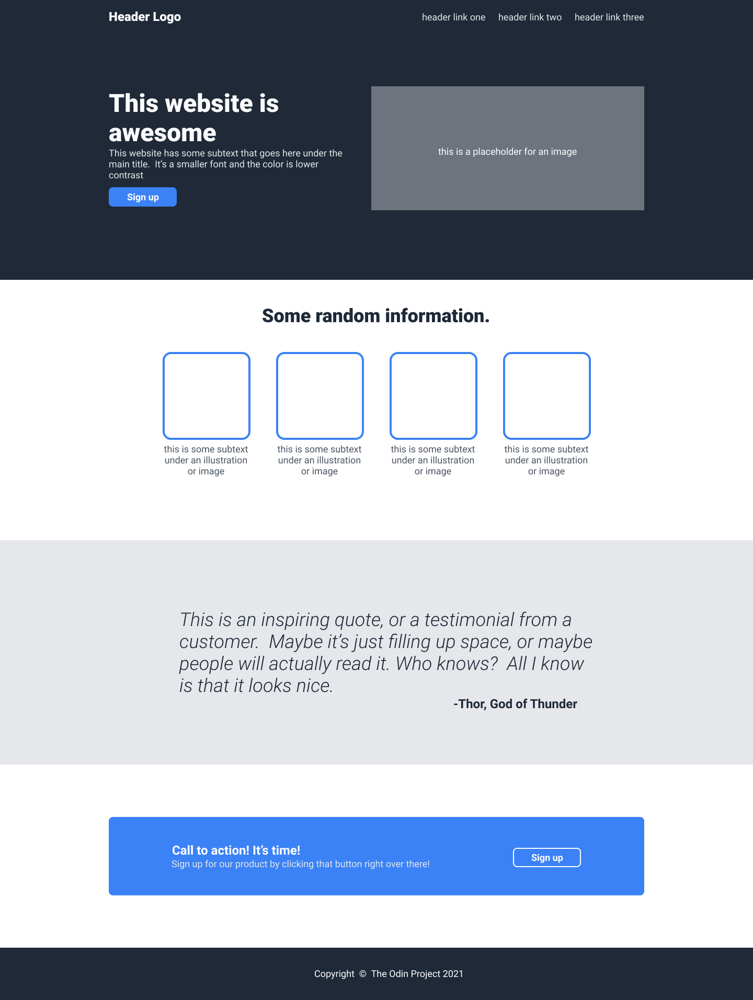
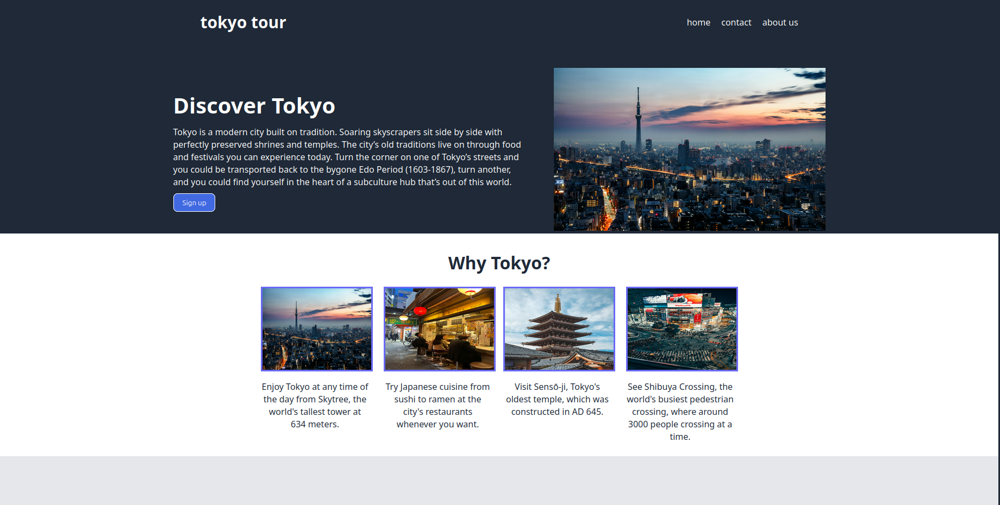
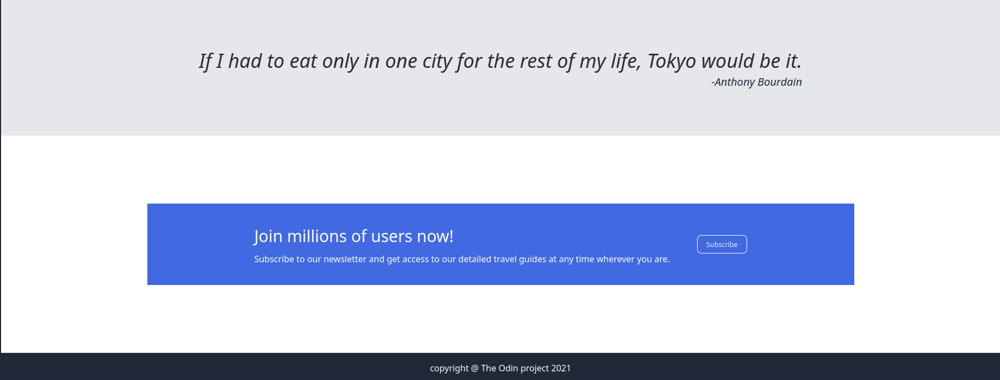

# odin-landingpage

This is the webpage I made to the [Landing Page project](https://www.theodinproject.com/lessons/foundations-landing-page) of The Odin Project 
The purpose of this project is to apply all the concepts learned in the Flexbox part of The Odin Project's Foundations curriculum 
Design used as a reference
 
The screenshot of the webpage i made ( or [click here](https://amitkumbhakar.github.io/odin-landingpage/) to see a live preview):   

